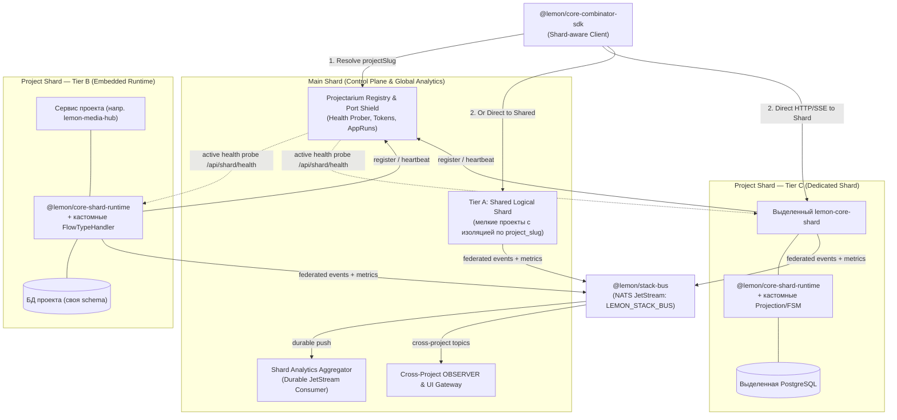

# Архитектура проектных шардов Lemon Core (`Project Shards`)

> **Статус:** Архитектурный проект (Target Design)  
> **Связанные подсистемы:** `lemon-core` (`apps/api/src/flows`), `@lemon/core-combinator`, `@lemon/core-combinator-sdk`, `@lemon/stack-bus` (NATS JetStream), `lemon-projectarium`  
> **Предпосылки:** На текущем этапе закрыты базовые P0/P1 узкие места в монолитном `FlowsService` / `FlowSchedulerService` / `LemonBusRelayService`. Следующий шаг — переход от одной общей базы всех проектов к федеративной модели **Main Control Plane + Project Shards**.

---

## 1. Зачем переходить к проектным шардам

Единая таблица `flows` / `flow_events` и единый процесс `lemon-core` плохо масштабируются на большое число проектов по трём причинам:

1. **Изоляция расширений и доменной логики.** Разным проектам нужны собственные `PROJECTION`-редьюсеры, правила `FSM`, политики `BATCH` и кастомные `FlowType`. В монолитной модели доменная логика проектов неизбежно просачивается в общее ядро (как это уже произошло со `space-towers` внутри `FlowsService.reduceProjectionState`).
2. **Эффект «шумного соседа» (Noisy Neighbor).** Один высоконагруженный проект с активным `PROJECTION`, `BATCH` или `OBSERVER` перегружает общий пул PostgreSQL, буферы `StreamLoadOptimizer` и таблицу `flow_events`, влияя на задержки `MUTEX` и `TIMER` других проектов.
3. **Индивидуальные SLA и политики хранения.** Одному проекту нужен ретеншн событий 7 дней и строгий in-memory/Redis lease для миллисекундных блокировок, другому — 1 год аудита `FlowSession` в PostgreSQL и агрессивный coalescing импульсов.

---

## 2. Целевая топология: Control Plane + 3 тира шардов

Вместо жёсткого «под каждый мелкий проект — отдельный сервер и отдельная БД» используется единый **контракт шарда**, который может разворачиваться в одном из трёх режимов (тиров):



### Сравнение тиров развёртывания

| Тир | Где исполняется `flows` | Хранилище | Когда использовать |
| :--- | :--- | :--- | :--- |
| **Tier A: Logical Shard** | Внутри Main Shard (`lemon-actions`) | Общая БД с обязательным `project_slug` (партиционирование `flow_events` по `project_slug` / времени) | Простые утилиты, эксперименты, прототипы с низкой нагрузкой |
| **Tier B: Embedded Shard** | Внутри процесса самого проекта (NestJS/Node) как библиотека `@lemon/core-shard-runtime` | Существующая БД проекта (отдельная PG-схема `lemon_core_*` или свои таблицы) | Проекты со своим бэкендом (`lemon-media-hub`, `lemon-seasons`, `lemon-ai-service`): **0 сетевых hop'ов** на `MUTEX`/`FSM`/`PROJECTION` |
| **Tier C: Dedicated Shard** | Отдельный процесс/контейнер `lemon-core-shard` на порту `4320+` (через Port Shield) | Собственная выделенная PostgreSQL (+ опционально Redis для hot-leases) | High-load проекты, изолированные игровые/агентные миры, тяжёлые `PROJECTION` и индивидуальный retention |

> **Ключевое свойство:** для `Projectarium`, админки в `lemon-actions` и `@lemon/stack-bus` шарды **Tier A, Tier B и Tier C выглядят одинаково** за счёт единого контракта регистрации, health-эндпоинта и NATS-топиков.

---

## 3. Расширяемое ядро шарда (`@lemon/core-shard-runtime`)

Чтобы каждый шард мог задавать **индивидуальные условия** и **расширять базовые типы потоков** без форка репозитория, `FlowsService` и `FlowSchedulerService` декомпозируются в подключаемое ядро:

### 3.1. Полноценный контракт `FlowTypeHandler` (Runtime Strategy)

Сейчас `FlowTypeHandler` в `apps/api/src/flows/handlers/flow-type.handler.ts` умеет только `validateConfig()`. В целевой модели хэндлер владеет всем жизненным циклом своего типа:

```ts
export interface FlowRuntimeContext {
  flow: FlowRecord;
  tx: TransactionContext;
  emitImpulse: (packet: Omit<FlowImpulsePacket, 'id' | 'timestamp'>) => void;
  appendInternalEvent: (eventType: string, payload: Record<string, unknown>) => Promise<void>;
}

export interface FlowTypeHandler<TConfig = Record<string, unknown>> {
  readonly type: string; // базовый FlowType или кастомный 'RATE_LIMIT' | 'SAGA' | ...

  validateConfig(config: unknown): void;

  /** Вызывается при переходе в ACTIVE/PROCESSING */
  onActivate?(ctx: FlowRuntimeContext): Promise<void>;

  /** Вызывается при выходе из ACTIVE/PROCESSING */
  onDeactivate?(ctx: FlowRuntimeContext, reason: string): Promise<void>;

  /** Обработка входящего события внутри транзакции appendEvent */
  onEvent?(
    ctx: FlowRuntimeContext,
    event: { eventType: string; source: string; payload: Record<string, unknown>; createdAt: Date },
  ): Promise<{ updatedConfig?: TConfig } | void>;

  /** Вызывается шедулером, если поток попал в выборку активных задач */
  onTick?(ctx: FlowRuntimeContext, now: Date): Promise<void>;
}
```

### 3.2. Реестр проекционных редьюсеров (`ProjectionReducerRegistry`)

Бизнес-логика вроде `space-towers` выносится из общего `FlowsService` в именованные редьюсеры, которые регистрирует **конкретный проект/шард**:

```ts
export interface ProjectionReducer<TState = Record<string, unknown>> {
  readonly reducerKey: string; // например: 'space-towers/vault' | 'ai/usage-quota'
  reduce(
    prevState: TState,
    eventType: string,
    payload: Record<string, unknown>,
    config: Record<string, unknown>,
    at: Date,
  ): TState;
}
```

Конфиг `PROJECTION`-потока ссылается на `config.reducerKey`. Неизвестный `reducerKey` на уровне другого шарда просто не исполняется (или отклоняется на `validateConfig`).

### 3.3. Конфигурация условий шарда (`ShardPolicyConfig`)

Каждый шард при старте загружает свою политику использования `lemon-core`:

```ts
export interface ShardPolicyConfig {
  projectSlug: string;
  shardId: string;
  tier: 'logical' | 'embedded' | 'dedicated';

  /** Индивидуальные интервалы и лимиты */
  schedulerTickMs: number;          // по умолчанию 15000, для fast-шарда напр. 2000
  touchThrottleMs: number;          // троттлинг updated_at при heartbeats
  eventRetentionDays: number | null;// авто-очистка старых flow_events
  maxPendingBatchItems: number;

  /** Настройки StreamLoadOptimizer под профиль проекта */
  coalesceRules?: Partial<Record<FlowImpulseType, CoalesceRule>>;

  /** Какие события транслировать наружу в Main Shard через StackBus */
  federation: {
    publishFlowImpulses: boolean;
    federatedImpulseTypes: FlowImpulseType[]; // напр. ['MUTEX_STATUS', 'CIRCUIT_BREAKER_STATE', 'BATCH_FLUSH']
    metricsIntervalSec: number;               // по умолчанию 30
  };
}
```

---

## 4. Подключение шардов к Main Shard: Discovery, Health и Аналитика

Вся связность строится поверх уже существующих компонентов `Projectarium` и `@lemon/stack-bus`, **без прямых межсервисных SSE-подписок и без прямых запросов в чужие БД** (в соответствии с `.agents/rules/inter-service-bus.md` и `.agents/rules/port-allocation.md`).

### 4.1. Регистрация шарда и Port Shield (`Projectarium`)

При запуске (Tier B или Tier C) шард вызывает `POST /api/projectarium/register`:

```json
{
  "projectSlug": "lemon-space",
  "projectName": "Lemon Space",
  "appName": "lemon-core-shard",
  "role": "core-shard",
  "environment": "dev",
  "networkMode": "local",
  "healthUrl": "http://localhost:4324/api/shard/health",
  "context": {
    "shard": {
      "shardId": "shard-lemon-space-01",
      "tier": "dedicated",
      "apiBaseUrl": "http://localhost:4324/api",
      "capabilities": ["MUTEX", "FSM", "PROJECTION", "BATCH", "OBSERVER"],
      "customFlowTypes": ["TOWER_ECONOMY"],
      "customReducers": ["space-towers/vault", "space-towers/emitter"],
      "schemaVersion": "00000000000009"
    }
  }
}
```

Что это даёт сразу:
1. **Выделение порта (Tier C)** или **регистрация адреса (Tier B)** в одном реестре `Projectarium`.
2. **Встроенный Health Monitor (`reapAndProbeAll`)**: Main Shard уже опрашивает `healthUrl` каждые 30 секунд, измеряет `pingLatencyMs`, считает `consecutiveFailures` и переводит шард в `ONLINE` → `DEGRADED` → `EVICTED` с записью в `ProjectariumAppRunRecord` и публикацией `lemon.projectarium.app.*` на шину.

### 4.2. Расширенный контракт `GET /api/shard/health`

Эндпоинт здоровья шарда отдаёт не только `200 OK`, но и компактный диагностический срез для админки и пробера:

```json
{
  "status": "OK",
  "projectSlug": "lemon-space",
  "shardId": "shard-lemon-space-01",
  "tier": "dedicated",
  "uptimeSec": 14820,
  "db": { "connected": true, "latencyMs": 2 },
  "bus": { "driver": "nats", "connected": true },
  "flows": {
    "total": 42,
    "active": 11,
    "paused": 2,
    "openSessions": 7,
    "openCircuitBreakers": 0
  },
  "scheduler": {
    "lastTickDurationMs": 4,
    "lastTickLagMs": 12,
    "schedulableCount": 6
  },
  "optimizer": {
    "reductionRatePct": 63.4,
    "pendingCoalesceBuffers": 3
  }
}
```

### 4.3. Федерация аналитики через `@lemon/stack-bus` (NATS JetStream)

Чтобы Main Shard мог строить сквозную аналитику по всем проектам без нагрузки на шарды, используется разделение событий на **локальные** (`local`) и **федеративные** (`federated`):

| Назначение | NATS-топик | Частота / Режим | Куда попадает в Main Shard |
| :--- | :--- | :--- | :--- |
| **Снапшот метрик шарда** | `lemon.<projectSlug>.shard.metrics` | Раз в `30s`, `dedupKey: shard:<id>:<minuteBucket>` | `ShardMetricSnapshot` (графики нагрузки, RPS, reductionRate, задержки БД/шедулера) |
| **Lifecycle-изменения шарда** | `lemon.<projectSlug>.shard.registered` / `degraded` / `draining` | По событию | Хроника `Projectarium` + алерты админа |
| **Значимые факты потоков** | `lemon.<projectSlug>.flow.<event>` | Только для `federatedImpulseTypes` (`MUTEX_STATUS`, `CIRCUIT_BREAKER_STATE`, `BATCH_FLUSH`, `FSM_TRANSITION`) | Глобальный `OBSERVER`, сквозная аналитика SLA/отказов, `Projectarium` chronicle |
| **Высокочастотный шум** | *не публикуется в NATS* (остаётся в `FlowsEventBusService` шарда) | Локально (`TIMER_TICK`, `heartbeat`, внутренние шаги) | Не покидает шард — экономия сети и диска NATS |

На стороне Main Shard работает **один durable JetStream consumer** (`durableName: 'main_shard_analytics'`), подписанный на:
- `lemon.*.shard.>`
- `lemon.*.flow.>`

Даже если Main Shard перезагрузится или уйдёт на обслуживание, NATS JetStream сохранит события шардов и дошлёт их после восстановления без потери аналитики.

### 4.4. Управление и администрирование шардами (Control Actions)

Админ-панель (`apps/web`) подключается к Main Shard (`Projectarium`), получает список всех активных шардов (`GET /api/projectarium/shards`) и для администрирования конкретного шарда работает по одной из двух моделей:
1. **Чтение сводки (Offline-safe):** читает агрегированные метрики, последние алерты, `health` и историю `AppRun` прямо из Main Shard (работает даже если шард сейчас упал/отключён).
2. **Оперативное управление (Live Admin):**
   - UI обращается к API конкретного шарда по `apiBaseUrl` из `Projectarium` (с передачей `projectToken` / `Authorization`) для просмотра локальных `flows` и `flow_events` без дублирования сырых таблиц в Main DB;
   - либо Main Shard отправляет управляющие команды (`shard.pause_all`, `shard.flush_batch`, `shard.reload_policy`) через NATS-топик `lemon.<projectSlug>.shard.command` (с `correlationId` и ack-ответом), что работает даже для приватных/локальных шардов за NAT, у которых открыто только исходящее подключение к NATS.

---

## 5. Маршрутизация клиентов (`@lemon/core-combinator-sdk`)

Чтобы прикладной код проектов не менялся при миграции проекта из `Tier A` (общая база) в `Tier B` или `Tier C` (свой шард), `@lemon/core-combinator-sdk` получает лёгкий резолвер маршрута:

```ts
const client = await CoreCombinatorClient.forProject({
  projectSlug: 'lemon-space',
  projectariumUrl: 'http://localhost:3000/api',
  fallbackBaseUrl: 'http://localhost:3000/api', // Tier A fallback
  cacheTtlMs: 30_000,
});
```

Алгоритм работы SDK:
1. Запрашивает `GET /api/projectarium/shards/resolve?projectSlug=lemon-space` (либо берёт из кэша на 30 с).
2. Если у проекта зарегистрирован `ONLINE` шард (`role === 'core-shard'`), SDK направляет HTTP/SSE-запросы (`flows`, `neurons`, `batch`, `chronicle`) напрямую на `shard.apiBaseUrl` — минуя Main Shard.
3. Если отдельного шарда нет (или проект работает в режиме `Tier A`), SDK автоматически работает с Main Shard, проставляя заголовок `x-project-slug: lemon-space`.
4. При ошибке соединения (`ECONNREFUSED` / `503`) SDK сбрасывает кэш резолвера и делает однократный re-resolve через `Projectarium`.

---

## 6. План поэтапного внедрения

| Этап | Что делаем | Результат |
| :--- | :--- | :--- |
| **Этап 1. Ядро как плагинная библиотека** | Вынести runtime-логику `FlowsService` + `FlowSchedulerService` + `FlowTypeRegistry` + `ProjectionReducerRegistry` в пакет `@lemon/core-shard-runtime`; вынести `reduceProjectionState` `space-towers` из ядра в проектный плагин. | Базовое ядро не содержит логики конкретных проектов и готово к встраиванию. |
| **Этап 2. Контракт шарда в `Projectarium` и `NATS`** | Добавить эндпоинт `/api/shard/health` и резолвер `GET /api/projectarium/shards/resolve`; добавить периодическую публикацию `lemon.<slug>.shard.metrics` и durable-агрегатор в Main Shard. | Main Shard видит все шарды, их health, latency и сводные метрики в реальном времени. |
| **Этап 3. Первый пилотный шард (Tier B или Tier C)** | Вынести один домен (например, `lemon-space` или `lemon-media-hub-neurons`) на собственный `core-shard`, переключить `CoreCombinatorClient.forProject(...)`. | Подтверждена изоляция нагрузки и кастомных редьюсеров без деградации Main Shard. |
| **Этап 4. Сквозной Admin UI и политики ретеншна** | В `apps/web` добавить панель «Shards Topology & Health» (статус, latency, reduction rate, переключение контекста в конкретный шард) и фоновую очистку `flow_events` по `eventRetentionDays`. | Полная управляемость кластером проектных шардов из единого окна. |
